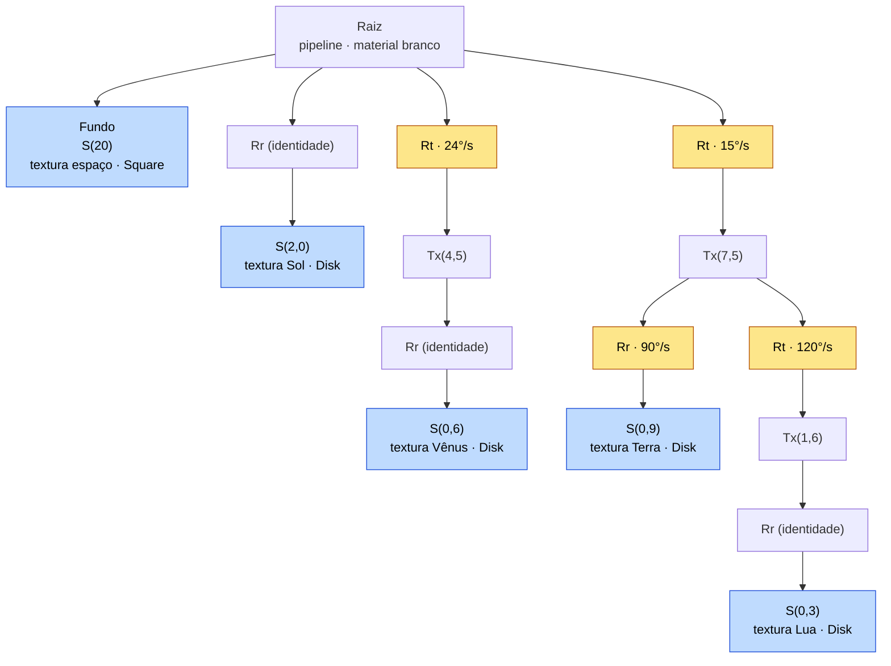
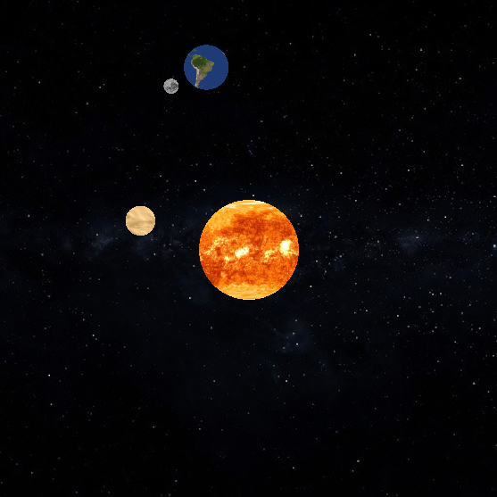

# Projeto 1 – Cena 2D com textura e animação

**INF1761 – Computação Gráfica** — Prof. Waldemar Celes

**Aluno:** Oliver Hoerde — **Matrícula:** 2310789

**Vídeo de demonstração:** https://drive.google.com/file/d/1FbCMFV9Y3w0ns2Kw6Zqmzq7MlnF7fVIE/view?usp=sharing

**Repositório com o código-fonte:** https://github.com/olivernap/INF1761_projeto01

---

## 1. Objetivo

O projeto implementa, em Python com WebGPU (`wgpu` + `rendercanvas`), a animação de um mini-sistema solar bidimensional em vista superior, composto por Sol, Vênus, Terra e Lua. A cena é modelada por um grafo de cena, e todos os astros e o fundo recebem textura.

| | |
|---|---|
| Grafo de cena modelando o sistema | Árvore de `Node` do framework `scene_graph-alunos` |
| Translação da Terra em torno do Sol | Nó de rotação `Rt` da órbita da Terra, girado por um `Spin` a 15°/s |
| Rotação da Terra em torno do próprio eixo, sem ser herdada pela Lua | Nó `Rr` próprio da Terra, irmão da órbita da Lua |
| Translação da Lua em torno da Terra | Órbita da Lua pendurada no nó de translação da Terra |
| Astro adicional entre o Sol e a Terra | Vênus, órbita de raio 4,5 (a Terra orbita a 7,5) |
| Texturas nos astros, com a rotação da Terra visível | Textura da América do Sul, assimétrica, no disco da Terra |
| Textura de fundo representando o espaço | Quadrado texturizado com um campo de estrelas, desenhado primeiro |

## 2. Organização do código

O código usa o framework de grafo de cena disponibilizado na disciplina (`scene_graph-alunos`) como fonte principal. Nada do que o framework já oferece foi reimplementado: os módulos usados (e suas dependências) foram copiados, sem alteração, para a pasta `scr/`, e o programa principal os importa de lá.

```
Projeto01/
├── solar_system.py      programa principal
├── shaders/
│   └── texture.wgsl     shader 2D com textura
├── images/              texturas dos astros e do fundo
└── scr/                 módulos copiados de scene_graph-alunos/python (sem alteração)
```

**Reaproveitado do framework (`scr/`):** `Node`, `Transform`, `Scene`, `Engine`, `Camera2D`, `Renderer`, `State`, `Pipeline`, `Shader`, `ColorMaterial`/`Material`, `Texture`, `Sampler`, `TextureSet`, `Square` e a infraestrutura de que dependem (`graphics_math`, `uniformbuffer`, `wgslreflect` etc.).

**Desenvolvido para o trabalho (`solar_system.py` e `shaders/texture.wgsl`):**

- `Disk` — subclasse de `Shape`: o disco com coordenadas de textura.
- `Spin` — subclasse de `Engine`: gira um `Transform` em torno de z a uma velocidade constante.
- Funções auxiliares de montagem do grafo (`body`, `orbit`, `textured`) e a montagem da cena em `initialize`.
- O shader `texture.wgsl`.

## 3. Grafo de cena

### 3.1 Estrutura

A árvore segue a hierarquia de transformações vista na aula de animação: cada astro é desenhado por uma cadeia `Rt · Tx · Rr · S`. `Rt` é a rotação que produz a translação orbital, `Tx` o raio da órbita, `Rr` a rotação em torno do próprio eixo e `S` a escala (o raio do astro). Pipeline, material e transformações são herdados pelos descendentes; somente as formas são locais a cada nó.

```
raiz  [pipeline, material branco]
├── fundo        S(20)                          [textura espaço]   Square
├── sol          Rr · S(2,0)                    [textura sol]      Disk
├── órbita Vênus Rt(24°/s) · Tx(4,5)
│   └── Vênus    Rr · S(0,6)                    [textura Vênus]    Disk
└── órbita Terra Rt(15°/s) · Tx(7,5)
    ├── Terra    Rr(90°/s) · S(0,9)             [textura Terra]    Disk
    └── órbita Lua  Rt(120°/s) · Tx(1,6)
        └── Lua  Rr · S(0,3)                    [textura Lua]      Disk
```



*Figura 1 – Grafo de cena. Cada caixa é um `Node` com um único `Transform`. Em amarelo, os nós girados por uma `Spin`; em azul, os nós que desenham uma forma com textura. `Rr · 90°/s` da Terra e a órbita da Lua são irmãos sob `Tx(7,5)`, por isso a Lua não herda a rotação da Terra.*

Cada `Rt`, `Tx`, `Rr` e `S` é um `Transform` em seu próprio `Node`. Os nós são criados por duas funções auxiliares: `orbit(raio, filhos)` monta a cadeia `Rt · Tx`, e `body(disco, textura, raio)` monta `Rr · S` com a forma e a textura. Separar as transformações em nós distintos tem duas vantagens:

1. As `Engine`s só acumulam rotações puras, em nós que não contêm nem translação nem escala. Por isso a composição quadro a quadro (`mat @ R`) nunca distorce a matriz.
2. Cada filho herda exatamente o que deve herdar: a Lua pendura-se no nó de translação da Terra, e não no nó de escala nem no de rotação própria.

### 3.2 A Lua não herda a rotação da Terra

É o ponto central do enunciado. O nó `Rr` da Terra e a órbita da Lua são **irmãos**, ambos filhos de `Tx(7,5)`. Assim, a Lua herda a posição da Terra (`Rt · Tx`), mas não a sua rotação própria nem a sua escala. Isso corresponde ao diagrama "Com rotação da Terra" dos slides de animação, em que `Rr` aparece apenas no ramo da Terra. Como o `Node.render` descarrega o estado em ordem reversa ao sair de uma subárvore, o `Rr` da Terra já foi desempilhado quando a travessia chega à Lua.

Como consequência, a Lua gira em torno do próprio centro junto com a sua órbita e mantém sempre a mesma face voltada para a Terra (rotação sincronizada, como a Lua real). O mesmo vale para Vênus em relação ao Sol.

### 3.3 Animação

As velocidades, em graus por segundo, foram escolhidas para uma animação legível, mantendo a proporção aproximada entre os períodos de Vênus e da Terra:

| Movimento | Velocidade | Período |
|---|---|---|
| Translação da Terra | 15°/s | 24 s ("ano") |
| Translação de Vênus | 24°/s | 15 s (≈ 0,62 ano, próximo da razão real 225/365) |
| Rotação da Terra | 90°/s | 4 s ("dia") |
| Translação da Lua (relativa à Terra) | 120°/s | 3 s ("mês") |

Cada movimento é uma instância de `Spin`, registrada na `Scene` com `add_engine`:

```python
class Spin (Engine):
  def __init__ (self, trf, speed):
    self.trf = trf
    self.speed = speed
  def update (self, dt):
    self.trf.rotate(self.speed*dt, 0, 0, 1)
```

O laço segue o padrão `update(dt)` da aula de animação: `update_mode="continuous"`, o `dt` medido com `time.perf_counter()` a cada quadro, e `scene.update(dt)` chamado antes de `renderer.render`.

## 4. Texturas

### 4.1 Geometria com coordenadas de textura

Todos os astros usam uma única instância de `Disk`: um leque de 64 triângulos em torno de um vértice central, expandido em uma lista de triângulos indexada, porque a WebGPU não tem a topologia *triangle-fan*. As coordenadas de textura seguem a fórmula dos slides, com o disco inscrito no quadrado da textura e `t` crescendo para baixo (origem no canto superior esquerdo, convenção da WebGPU):

s_i = 0,5 + 0,5 cos θ_i  t_i = 0,5 − 0,5 sen θ_i

As posições e as coordenadas de textura ficam em dois buffers de vértice independentes (slots 0 e 1), como em `Square` e `Quad` do framework. Com isso, a própria geometria recorta a imagem em forma de círculo, sem precisar de transparência. O fundo é um `Square` do framework, escalado para 20 × 20 unidades. Esse tamanho é maior que a janela de visão (−10 a 10) e cobre a tela mesmo quando a `Camera2D` expande um dos eixos para corrigir a razão de aspecto.

### 4.2 Shader

O framework traz um shader 2D apenas com cor (`shaders/2d/shader.wgsl`) e shaders texturizados apenas com iluminação 3D. Por isso foi escrito `texture.wgsl`: o shader 2D do framework, acrescido do que os slides de textura descrevem. O vértice repassa `texcoord`, que é interpolada na rasterização, e o fragmento amostra a textura e **modula** a cor do material:

```wgsl
@group(3) @binding(0) var decal_texture: texture_2d<f32>;
@group(3) @binding(1) var decal_sampler: sampler;

@fragment
fn fs_main (in: VertexOutput) -> @location(0) vec4<f32> {
  let texel = textureSample(decal_texture, decal_sampler, in.texcoord);
  return vec4<f32>(material.color, material.opacity) * texel;
}
```

Os grupos seguem as convenções que `Shader` descobre por reflexão: `matrix` (grupo 0), `material` (grupo 1), `global` (grupo 2) e um único grupo só de textura e sampler (grupo 3). Um `ColorMaterial(1,1,1)` branco, na raiz do grafo, é herdado por todos os nós. Com ele, o texel passa intacto, e a mesma estrutura permitiria tingir um astro apenas trocando o material de um nó.

### 4.3 Recursos de textura

Cada imagem vira um `Texture` do framework (`rgba8unorm-srgb`, linearizada na amostragem). Todas compartilham um único `Sampler` (filtro linear, `clamp-to-edge`), porque, como dizem os slides, "o mesmo sampler serve a várias texturas". Cada par textura + sampler forma um `TextureSet`, registrado no shader com `add_texture_set` durante a inicialização e colocado nas `apps` do nó que desenha o astro. A troca de textura entre astros é, portanto, apenas a troca de um *bind group* durante a travessia.

O `Texture` do framework não gera a pirâmide de mipmapping. Para evitar serrilhado de redução (um disco pequeno cobrindo uma imagem grande), as imagens foram reduzidas previamente na CPU para um tamanho próximo do que ocupam na tela: 256² para o Sol, 128² para Vênus e para a Terra, 64² para a Lua e 1024² para o fundo. Os mapas originais, equirretangulares (2:1), tiveram recortado o quadrado central, para que o disco inscrito não achatasse a imagem.

**Visibilidade da rotação da Terra:** a textura da Terra é a imagem `terra_512.png` do próprio `scene_graph-alunos`, que mostra a América do Sul. Como não tem simetria rotacional, a orientação do continente deixa evidente a rotação do astro em torno do próprio eixo.

**Origem das imagens:** Terra — `scene_graph-alunos/images/terra_512.png`; Sol, Vênus (atmosfera), Lua e campo de estrelas (Via Láctea) — Solar System Scope (<https://www.solarsystemscope.com/textures/>), licença CC BY 4.0.

## 5. Resultados



*Figura 2 – Cena completa: o Sol no centro, Vênus em sua órbita interna e a Terra, acompanhada da Lua, na órbita externa, sobre o fundo de estrelas.*

A cena roda em tempo real (60 quadros por segundo, limitados por `max_fps`), com o fundo sempre atrás dos astros. Não há teste de profundidade: a ordem de desenho é a ordem da travessia (fundo, Sol, Vênus, Terra, Lua), definida pela ordem dos filhos em cada nó.

A animação também foi conferida numericamente, lendo `get_model_matrix()` dos nós em vários instantes e renderizando a cena para uma textura fora da tela:

- O Sol permanece exatamente na origem. As distâncias Vênus–Sol, Terra–Sol e Lua–Terra mantêm-se em 4,500, 7,500 e 1,600.
- Em t = 2 s, a orientação da Terra é 30° (órbita) + 180° (rotação própria) = 210°. A da Lua é 30° (órbita da Terra) + 240° (órbita da Lua) = 270°, sem nenhuma parcela da rotação da Terra. Isso confirma que a Lua não herda o `Rr` da Terra.

## 6. Conclusão

O trabalho atende a todos os requisitos do enunciado usando o framework da disciplina praticamente como fornecido. Todo o comportamento de travessia, herança de estado, matrizes e *bind groups* vem de `scene_graph-alunos`. O código específico do projeto limita-se a uma forma (`Disk`), uma engine (`Spin`), um shader 2D com textura e a montagem do grafo. A separação de cada astro em nós `Rt · Tx · Rr · S` torna explícito, na própria estrutura da árvore, o que cada astro herda do seu "pai". Com isso, a exigência de que a Lua não acompanhe a rotação da Terra fica garantida pela posição do nó no grafo, sem nenhuma lógica adicional.
